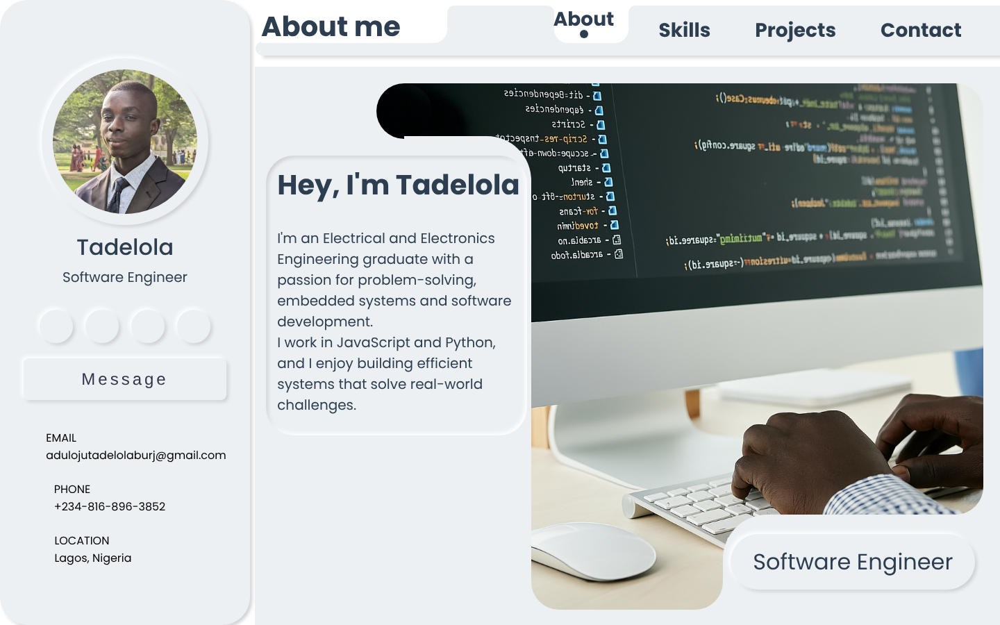

# Personal Portfolio

My personal portfolio site: who I am, my skills, projects and how to reach me.



## Features

- About section with education and experience
- Animated skill meters for front-end and programming languages
- Projects gallery with filters (All, Websites, Web Apps)
- Contact form and click-to-copy email and phone
- Soft "neumorphic" design built from scratch

## Built with

- HTML5, CSS3 and vanilla JavaScript
- Google Fonts (Poppins, Courier Prime) and Font Awesome icons
- No frameworks or templates

## Run it locally

Clone the repo and open `index.html` in a browser:

```bash
git clone https://github.com/burjnx/personal-portfolio.git
cd personal-portfolio
```

## Contact

**Tadelola Aduloju** · Lagos, Nigeria · [adulojutadelolaburj@gmail.com](mailto:adulojutadelolaburj@gmail.com)
