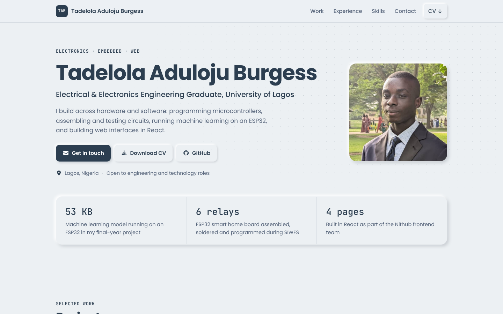
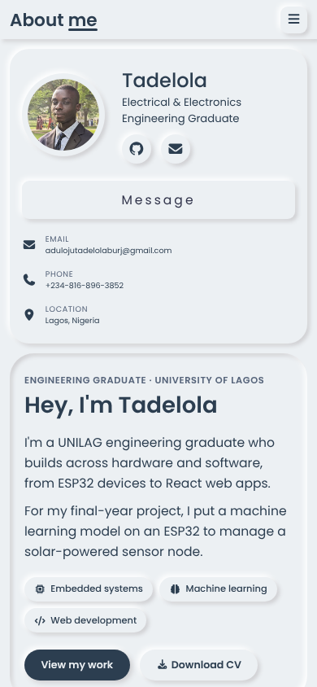

# Personal Portfolio

My personal portfolio site as an Electrical and Electronics Engineering graduate: who I am, my skills, projects and how to reach me.





## Features

- Fully responsive: desktop sidebar layout, tablet and phone layouts with a menu button
- Animated education and experience timeline, with a SIWES details pop-up and photo gallery
- Skills grouped into engineering and hardware, programming and web, data and ML, and office tools
- Download CV button
- Projects with Hardware / Web filters; hardware projects open detail pop-ups (system diagram, results, photos), Tasker opens its live demo
- Contact form that opens a pre-filled email (no backend needed on GitHub Pages)
- Click-to-copy email and phone
- Soft "neumorphic" design built from scratch

## Built with

- HTML5, CSS3 and vanilla JavaScript
- Google Fonts (Poppins), Font Awesome icons and GSAP for small animations
- No frameworks or templates

## Run it locally

Clone the repo and open `index.html` in a browser:

```bash
git clone https://github.com/burjnx/personal-portfolio.git
cd personal-portfolio
```

## Contact

**Tadelola Aduloju** · Lagos, Nigeria · [adulojutadelolaburj@gmail.com](mailto:adulojutadelolaburj@gmail.com)
